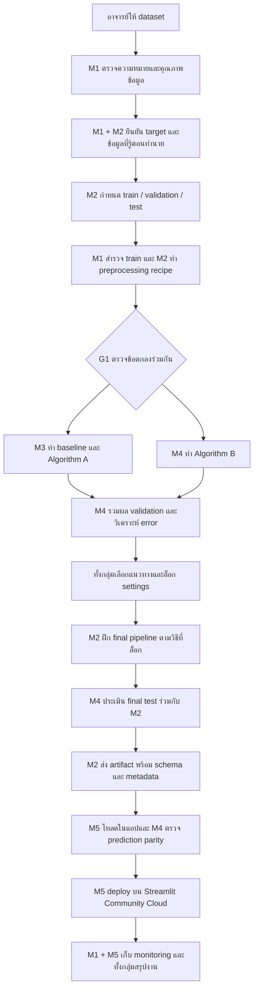

# Workflow จากข้อมูลถึงใช้งานโมเดล สำหรับสมาชิก 5 คน

แผนแบ่งงานตั้งต้นสำหรับคุยและใส่ชื่อจริงร่วมกัน สมาชิกทุกคนพัฒนาและทดสอบใน Google Colab อาจารย์เป็นผู้ให้ dataset ยังไม่เลือกชื่อคอลัมน์ อัลกอริทึม หรือโมเดลผู้ชนะให้ล่วงหน้า

M1–M5 ในเอกสารนี้เป็นรหัสบทบาท ไม่ใช่ชื่อคนที่ได้รับมอบหมายแล้ว กลุ่มเปลี่ยนการแบ่งได้ แต่ทุกช่วงต้องมีเจ้าของ ผู้ตรวจ และสิ่งส่งต่อ ทุกคนเขียนรายงานส่วนที่ตนทำ บันทึก contribution/prompts และร่วมสาธิต

## ภาพรวมการไหลของงาน

ลูกศรหมายถึงส่งงานหลังผ่านจุดตรวจ ไม่จำเป็นต้องให้คนที่อยู่ท้ายรอเฉย ๆ ระหว่างรอข้อมูลหรือ artifact ให้เตรียมงานตามตารางด้านล่าง

## 1. บทบาทของสมาชิกแต่ละคน

| สมาชิก | งานหลักที่ลงมือทำ | งานร่วมและหลักฐาน | ผู้ช่วยตรวจ |
| --- | --- | --- | --- |
| M1: ข้อมูลและบริบท | อ่านข้อมูล ยืนยันหน่วย/หนึ่งแถว/target ตรวจคุณภาพ ทำ EDA บน train และอธิบายสิ่งที่พบ | data dictionary, quality report, กราฟ, ส่วน CO1 และตรวจ input distribution ใน monitoring | M2 ตรวจ schema; M4 ตรวจข้อสังเกตกับผล error |
| M2: split และ preprocessing | เขียน split ที่ทำซ้ำได้ สร้าง preprocessing recipe รวมขั้นตอนใน pipeline และฝึก/บันทึก final artifact หลังกลุ่มล็อกวิธี | split manifest, preprocessing code, leakage checks, metadata และส่วนออกแบบ CO2 | M4 ตรวจเวลาและลำดับ fit/transform; M3 ลองใช้กับโมเดล A |
| M3: baseline และโมเดล A | เขียน baseline จาก train ทดลองอัลกอริทึม A ที่กลุ่มเลือก ปรับค่าบน validation และส่ง pipeline/ผลจริง | experiment log, settings, MAE/RMSE/R², คำอธิบายโมเดล A และหลักฐานทำซ้ำ | M4 ตรวจสูตร/ผล; M2 ตรวจ preprocessing |
| M4: โมเดล B และ evaluation | ทดลองอัลกอริทึม B ที่ต่างจาก A รวมผลเทียบ validation วิเคราะห์ error และประเมิน final test หลังล็อกวิธี | ผลโมเดล B, comparison table, error analysis, final test และ test log การเชื่อมแอป | M3 ตรวจโมเดล B/metrics; M2 ตรวจ artifact; ทั้งกลุ่มทบทวนการเลือก |
| M5: แอปและ deployment | เขียนช่องกรอก/validation โหลด pipeline จาก M2 ทดสอบ AppTest ใน Colab แล้วนำขึ้น Community Cloud | app.py, prediction parity ร่วม M4, ลิงก์จริง, screenshots, deployment notes และ logs ร่วม M1 | M1 ตรวจหน่วย/ความหมาย; M4 ตรวจค่าทำนายและกรณีผิด |

การแบ่งนี้แยกจุดที่แก้ไฟล์ชนกันและทำให้ทุกคนมีงานเชิงเทคนิค แต่ M2 และ M5 อาจมีภาระรวมระบบมาก กลุ่มควรให้ M3/M4 ช่วยทดสอบการส่งต่อ และให้ M1 ดูแลการเก็บหลักฐานข้อมูล/monitoring เพื่อกระจายงาน

สมาชิกทุกคนต้องรู้เส้นทางรวมตั้งแต่ X ไปถึง prediction และอธิบายส่วนของตนได้ ไม่ให้คนใดรับเฉพาะการรวมเอกสารหรือทำสไลด์ตลอดโครงงาน

## 2. ก่อนเริ่ม: ตั้งคำถามให้ตรงกัน

ทั้งกลุ่มคุยคำถาม 5 ข้อนี้กับข้อมูลจริงก่อนลงโค้ด:

1. หนึ่งแถวแทนชั่วโมง วัน หรือสถานี และ target มีหน่วยอะไร
2. ประเมินตามเงื่อนไขที่กรอก หรือทำนายล่วงหน้า ถ้าล่วงหน้าคือเท่าใด
3. แต่ละ feature รู้ได้ ณ เวลาทำนายจริงหรือไม่ โดยเฉพาะอากาศและยอดอดีต
4. ต้องประเมินช่วงอนาคตของสถานีเดิม หรือสถานีใหม่ที่ไม่เคยเห็น
5. มีข้อมูลเฉลย identifiers ส่วนประกอบของ target หรือสิทธิ์ข้อมูลที่ต้องระวังอะไร

เก็บคำตอบใน data_dictionary.csv และ decisions.md เรื่องที่ยังไม่รู้ให้มีผู้ติดตามกับอาจารย์ ไม่เติมสมมติฐานให้ดูเหมือนยืนยันแล้ว

## 3. ช่วงที่ 1: ตรวจข้อมูลและกำหนดการประเมิน

เจ้าของ: M1 และ M2 ผู้ตรวจ: M4

M1 เก็บต้นฉบับตามสิทธิ์ ตรวจ schema หน่วย ค่าที่หาย/ผิด และความหมายค่าศูนย์ M2 ใช้เวลาหรือ entity ที่ยืนยันแล้วกำหนด train/validation/test และกัน test ไว้ก่อนใช้รูปแบบข้อมูลตัดสินใจเรื่อง feature/preprocessing

จากนั้น M1 ทำ EDA เชิงตัดสินใจบน train สร้างกราฟและเขียนข้อสังเกต หากพบปัญหาใหม่ให้คุยกับ M2 ว่าวิธี split/preprocessing ต้องแก้อะไร การตรวจหัวตารางทั้งไฟล์เพื่อรู้โครงสร้างไม่ใช่การใช้ผล test มาเลือกโมเดล

สิ่งส่งต่อ:

- dataset version และที่มาที่ทุกคนอ้างตรงกัน อาจใช้ checksum ของไฟล์ต้นฉบับเป็นส่วนระบุรุ่น
- data_dictionary.csv และ config/project.json ที่ยืนยันชื่อคอลัมน์ หน่วย และ prediction context
- split manifest: กฎหรือรายการอ้างอิงแถว ช่วงเวลา จำนวนแถว และ seed หากใช้การสุ่ม โดยเผยแพร่เท่าที่สิทธิ์อนุญาต
- quality report และกราฟ train พร้อมเหตุผลที่เสนอใช้/ตัด feature

จุดตรวจ G0: M1/M2/M4 อธิบายได้ว่าหนึ่งแถวคืออะไร test ไม่ปนการเลือกวิธี และรายการเดียวกันไม่หลุดข้ามชุด หากทำนายอนาคตต้องรักษาลำดับเวลา ไม่กำหนดสัดส่วนตายตัวก่อนดูช่วงข้อมูลจริง

## 4. ช่วงที่ 2: สร้าง preprocessing ที่ใช้ร่วมกัน

เจ้าของ: M2 ผู้ตรวจ: M4 ผู้ทดลองรับงาน: M3

M2 เขียนโค้ดอ่านข้อมูลและใช้ split ตาม manifest ให้รันซ้ำได้ ออกแบบวิธีเติมค่าหาย แปลงหมวดหมู่ ปรับสเกลหรือสร้าง feature ตามเหตุผลจาก train โดยไม่แตะต้องต้นฉบับ

สิ่งที่ส่งให้ผู้ฝึกโมเดลคือโค้ดหรือ recipe ที่ยังไม่ fit ทั้งชุด ไม่ใช่ตารางที่ถูกแปลงด้วยการ fit ข้อมูลทั้งหมดแล้ว แต่ละโมเดลต้องประกอบ preprocessing กับ estimator แล้ว fit เฉพาะ train หากทำ cross-validation ต้อง fit preprocessing ใหม่ภายใน train ของแต่ละ fold

อัลกอริทึมต่างกันอาจต้องการ scaling ต่างกันได้ ให้ใช้ raw feature set, split และกฎข้อมูลเดียวกัน แล้วบันทึกส่วนที่ต่างพร้อมเหตุผล ห้ามทำให้โมเดลหนึ่งได้เห็นข้อมูลเพิ่มโดยไม่รายงาน

สิ่งส่งต่อ:

- วิธีโหลดข้อมูลและสร้าง split ที่ทำซ้ำได้ รวมคำสั่งหรือ cell ที่รันจากต้น
- preprocessing recipe/version และข้อยืนยันว่า target/คอลัมน์เฉลยไม่อยู่ใน X
- รายชื่อ feature ชนิดข้อมูล หน่วย และวิธีรับมือ missing/unknown category
- กฎสร้าง feature ตามเวลา หากมี lag/rolling ให้ใช้ข้อมูลที่รู้แล้ว ณ prediction time เท่านั้น

จุดตรวจ G1: M3 เปิด Colab runtime ใหม่แล้วได้ train/validation ชุดเดียวกับ M2 และ M4 ตรวจลำดับ fit/transform ผ่าน ก่อนแยกทดลองโมเดล A/B

ยังไม่เขียนวิธี preprocessing สำเร็จรูปแทนสมาชิกในโครงนี้ เพราะต้องเลือกจากข้อมูลจริงและอธิบายได้

## 5. ช่วงที่ 3: ฝึก baseline และสองอัลกอริทึมคู่ขนาน

เจ้าของ: M3 สำหรับ baseline/A และ M4 สำหรับ B ผู้ช่วยตรวจ: M2

ก่อนแยกงาน ทั้งสองคนตกลงชื่ออัลกอริทึม A/B ที่ต่างกัน บันทึกไว้ใน decisions ส่วน baseline เป็นวิธีง่าย เช่น ค่าเฉลี่ย target ของ train และต้องเพิ่มจากสองอัลกอริทึมนี้

M3/M4 เปิด notebook 04 จากต้นฉบับเดียวกันแล้วบันทึกสำเนาใน Drive แยกเป็นงาน A กับ B เมื่อส่งงานใช้ชื่อไฟล์ต่างกัน เช่น `04_member03_algorithm_A.ipynb` และ `04_member04_algorithm_B.ipynb` ไม่แก้ไฟล์เดียวพร้อมกัน ชื่อไฟล์เป็นข้อตกลงงาน ไม่ใช่ notebook ที่มีผลทดลองอยู่แล้ว

ทั้งคู่ต้องใช้ dataset version, raw features, split manifest และ preprocessing recipe รุ่นเดียวกัน หากต้องเปลี่ยนกฎร่วมให้หยุดเทียบผลรอบนั้น บันทึกรุ่นใหม่ แล้วรันผู้เกี่ยวข้องใหม่ให้เทียบกันได้

สิ่งส่งต่อของแต่ละโมเดล:

- notebook ที่รันจากต้นได้ใน Colab โดยไม่พึ่งตัวแปรของ notebook คนอื่น
- pipeline ที่ฝึกจาก train และโหลดได้ พร้อมชื่ออัลกอริทึม settings/seed และรุ่นไลบรารี
- MAE, RMSE และ R² บน validation ชุดที่ตกลง พร้อม experiment ID และเวลาที่วัดถ้ามี
- ข้อมูลอ้างอิงแถวและ prediction สำหรับวิเคราะห์ error ตามสิทธิ์ข้อมูล ไม่จำเป็นต้องเผยแพร่ raw records บน repo สาธารณะ
- สิ่งที่ปรับ เหตุผล และข้อจำกัด ห้ามเติมผลที่ยังไม่ได้วัด

M3 ส่ง baseline ด้วยการใช้ split/target เดียวกัน M4 ไม่ใช้ test เลือกโมเดล B แม้เป็นผู้รับผิดชอบ evaluation ในช่วงท้าย

จุดตรวจ G2: มี baseline เพิ่มจาก A/B ครบ ผล validation มาจากแถวเดียวกัน ผู้ตรวจทำซ้ำได้ และทุกผลระบุ experiment/data/split/recipe version ไม่เทียบคะแนนจากคนละชุด

## 6. ช่วงที่ 4: เปรียบเทียบและตัดสินใจร่วมกัน

เจ้าของตารางและ error analysis: M4 ผู้ตรวจ: M3 ผู้ตัดสินใจ: ทั้งกลุ่ม

M4 รวมผล baseline/A/B วิเคราะห์ช่วงที่ผิดมาก เช่น ช่วงยอดสูงหรือบางประเภทวันตามคอลัมน์จริง ตรวจว่า metrics คำนวณในหน่วย target เดียวกัน และกฎ clipping/rounding หากมีถูกใช้/รายงานสอดคล้องกัน

ทั้งกลุ่มเลือกจาก validation พร้อมพิจารณาความเร็ว ขนาด artifact และความสามารถในการอธิบาย ยังไม่ใช้ test เป็นตัวตัดสินหรือกลับไปปรับค่าจาก test ทีละรอบ

สิ่งส่งต่อ: comparison table, error analysis และ decision record ที่ล็อก algorithm, feature set, preprocessing, hyperparameters, กฎหลังทำนาย และวิธีฝึก final model

จุดตรวจ G3: สมาชิกทั้ง 5 อธิบายได้ว่าเลือกเพราะอะไรและเสียอะไรไปเมื่อเทียบทางเลือกอื่น ถ้าไม่มีวิธีใดดีกว่า baseline ต้องบันทึกตามจริงและตรวจปัญหาก่อนอ้างความสำเร็จ

## 7. ช่วงที่ 5: ฝึก final model ประเมิน test และบันทึก

เจ้าของ final pipeline: M2 เจ้าของผล test: M4 ผู้ตรวจรุ่น: M3

หลังล็อกวิธี M2 สร้าง pipeline ใหม่ตาม recipe/settings ที่เลือก ฝึกด้วยชุดที่ตกลง เช่น train รวม validation หากใช้วิธีนี้ต้อง fit preprocessing ใหม่บนชุดฝึกสุดท้ายและเก็บ test แยกไว้ M4 ประเมิน artifact ตัวสุดท้ายด้วย test เดิมและบันทึก MAE/RMSE/R² พร้อมข้อจำกัด

หากผล test แย่ ให้รายงานและตรวจความถูกต้องของการประเมิน การใช้ผลนั้นกลับไปเลือกหรือจูนแล้วรายงานว่า test ยังอิสระอยู่จะทำให้ข้อสรุปคลาดเคลื่อน หากเปลี่ยนแนวทางจริงต้องอธิบายการใช้ข้อมูลและข้อจำกัดใหม่

ส่งชุดเดียวกันให้ M5:

| สิ่งส่งต่อ | ใช้เพื่ออะไร |
| --- | --- |
| final pipeline/ไฟล์ preprocessing และโมเดลที่ตรงรุ่น | โหลด transformations และ estimator ชุดที่ประเมินแล้ว |
| input schema และหน่วย | สร้างช่องกรอกและแปลงข้อมูลถูกต้อง |
| metadata/model card | ตรวจ data/split/recipe/run ID รุ่น Python/ไลบรารี และบริบทใช้งาน |
| ผล final test | อธิบายประสิทธิภาพและข้อจำกัดของ artifact นี้ |
| prediction reference cases ที่ได้รับอนุญาต | เทียบค่าดิบจาก notebook กับแอปตาม tolerance ที่ตกลง |
| คำสั่งโหลดและตรวจใน runtime ใหม่ | ยืนยันว่าไม่อาศัยตัวแปรค้างใน Colab |

จุดตรวจ G4: M5 โหลดชุดที่ได้รับใน Colab runtime ใหม่แล้วให้ผลอ้างอิงตรงกัน M4 ตรวจ checksum/run ID ของ artifact อย่าประเมินไฟล์หนึ่งแต่ส่งอีกไฟล์ให้แอป

เก็บไฟล์ binary ตามข้อตกลงสิทธิ์และวิธีแจกของกลุ่ม `.gitignore` จะไม่เพิ่มไฟล์โมเดลให้อัตโนมัติ และการ upload ผ่านเว็บต้องตรวจไฟล์เองเสมอ

## 8. ช่วงที่ 6: นำโมเดลเข้าแอปและเผยแพร่

เจ้าของ: M5 ผู้ตรวจตัวเลข: M4 ผู้ตรวจความหมาย: M1

M5 ใช้ schema ของ M2 เขียน input controls/validation และโหลด final pipeline ไม่สร้าง preprocessing คนละชุดและไม่ฝึกใหม่ทุกครั้งที่กดปุ่ม ตรวจด้วย AppTest ใน Colab แล้วให้ M4 เทียบค่าดิบกับ reference cases ก่อนจัดรูปแบบแสดงผล

ทดสอบกรณีทั่วไป ขอบเขต ค่าผิด feature ไม่ครบ/หมวดหมู่ใหม่ตามกฎที่ตกลง และโหลด artifact ไม่ได้ บันทึก expected กับ actual รวมการแก้และตรวจซ้ำใน test_log.csv จากนั้นปรับ dependencies ฝั่งแอปให้เข้ากับรุ่นที่ฝึกจริง ส่งไฟล์ผ่านเว็บ GitHub แล้ว deploy บน Streamlit Community Cloud

จุดตรวจ G5: เปิดลิงก์จริงจาก session ใหม่ได้ หน่วยถูก artifact ถูกตัว และ prediction ตรง Colab ตาม tolerance ทั้งผู้ประเมินและสมาชิกเข้าถึงตามสิทธิ์ได้ AppTest ผ่านอย่างเดียวยังไม่ยืนยันหน้าจอและลิงก์ใช้งานจริง

## 9. ช่วงที่ 7: Monitoring และส่งงานทั้งกลุ่ม

M5 ดู logs/ข้อผิดพลาดของแอป M1 ดูลักษณะ input เทียบกับบริบทข้อมูลฝึก M4 ดู error ได้เมื่อมี actual outcome ที่จับคู่กับ prediction แล้ว บันทึก observation จริงและ review trigger ที่ตกลงร่วมกัน

หากมีแต่ prediction ยังไม่สรุปความแม่นจริงของการใช้งานใหม่ รายงานได้ว่าแอปทำงานหรือมี input ออกนอกช่วงบ่อยเพียงใด โดยระบุหลักฐานและข้อจำกัด

ทุกคนเขียนส่วนรายงานของตนพร้อมหลักฐาน ตรวจ contribution และ prompts อย่างน้อย 5 ช่วง รวมรายงาน PDF ตามข้อกำหนด และซ้อมอธิบายเส้นทางตั้งแต่ข้อมูลเข้าไปจนผลทำนายครบทั้ง 5 คน

จุดตรวจ G6: ข้ออ้างในรายงานตรวจย้อนกลับไปถึง run/artifact/test log ได้ มี monitoring จริงและลิงก์เปิดได้ ไม่มีแผนที่ยังไม่ได้ทำถูกเขียนเป็นผลสำเร็จ

## 10. งานที่เริ่มคู่ขนานได้ระหว่างรอ

| ช่วงที่รอ | M1 | M2 | M3 | M4 | M5 |
| --- | --- | --- | --- | --- | --- |
| รอ dataset | เตรียมคำถาม/data dictionary | ร่าง split/leakage checklist | ฝึก notebook 00 และอ่าน baseline | ฝึกอ่าน MAE/RMSE/R² และร่าง comparison template | อ่าน AppTest และดูโครง app.py |
| กำลังยืนยัน schema/split | ตรวจความหมายและคุณภาพ | เขียน split/recipe | เตรียมลำดับทดลอง A โดยยังไม่ใส่ผล | เตรียมลำดับทดลอง B และแบบ test | เตรียมโครงหน้าจอ/ข้อความตาม schema ที่ยืนยันแล้ว |
| กำลังทดลอง A/B | วิเคราะห์กราฟ train และช่วยตีความ | ช่วยแก้ preprocessing ส่วนร่วม | ฝึก A และ baseline | ฝึก B | ทำ validation ตาม input contract โดยยังไม่ทำนายปลอม |
| รอ final artifact | เขียน CO1/ตรวจหน่วย | ฝึก/บันทึก final pipeline | ตรวจการทำซ้ำและเขียนผล A | ตรวจ final test และรวมตาราง | เตรียมการโหลด/ทดสอบตาม contract |
| deploy แล้ว | monitoring input | ตรวจรุ่น artifact | ตรวจความเข้าใจรวม/หลักฐาน A | parity/test log และหลักฐาน B | deployment/logs/screenshots |

คู่ขนานได้เมื่อใช้ข้อตกลงเดียวกัน งานที่ต้องใช้ dataset/metrics จริงยังต้องรอ ไม่กรอกชื่อคอลัมน์หรือผลขึ้นมาแทน

## 11. กติกาส่งต่องานที่ลดปัญหารวมระบบ

ใช้ [แบบฟอร์ม handoff](../evidence/handoff_template.md) ทุกครั้งที่ข้ามผู้รับผิดชอบ ระบุ artifact/recipe version, input/output, วิธีรันใน Colab และผลที่ผู้รับควรตรวจ ส่งผ่านพื้นที่ Drive ที่อนุญาตหรือ GitHub ตามชนิดไฟล์

ตาราง task_board ที่เตรียมไว้เป็นงานเสนอและยังไม่มีชื่อจริง/ผลสำเร็จ ให้กลุ่มใส่คนและกำหนดส่งเอง ใช้ `not_started`, `in_progress`, `review`, `done`, `waiting` ตามจริง งานจะเป็น done เมื่อผู้รับลองและยืนยันแล้ว ไม่ใช่เมื่อผู้ส่งอัปโหลดเสร็จ

เมื่อเปลี่ยนข้อมูล/feature/split/recipe ให้ขึ้นรุ่นและบอกงานที่ต้องรันใหม่ หากเปลี่ยน preprocessing ต้องประเมินโมเดลที่เกี่ยวข้องใหม่ หากเปลี่ยน artifact ต้องตรวจ prediction parity และแอปใหม่ ส่วนแก้ข้อความเอกสารให้ตรวจเฉพาะเอกสารที่กระทบ

## 12. ข้อดีและข้อจำกัดของ workflow นี้

ข้อดี: สมาชิกมีเจ้าของงานเชิงเทคนิคครบ 5 คน ผู้ฝึก A/B ทำคู่ขนานได้ รู้ว่ารออะไร และใช้จุดตรวจร่วมเพื่อให้คะแนนเทียบกันได้ งานรายงานเกิดจากหลักฐานที่เก็บระหว่างทำ

ข้อจำกัด: M2 เป็นจุดพึ่งพาก่อนเริ่มฝึก และ M5 ต้องรอ artifact เพื่อปิดระบบ หากส่ง schema/รุ่นไม่ชัดอาจทำซ้ำมาก จึงควรส่งงานย่อยให้ลองเร็วและให้ผู้ตรวจช่วยลงมือ ไม่รอส่งก้อนใหญ่ตอนท้าย

กลุ่มยังต้องหารือชื่ออัลกอริทึม สัดส่วน/วิธี split วิธี preprocessing และชื่อคนตามข้อมูลจริง แผนนี้กำหนดลำดับและการส่งต่อเพื่อช่วยทำงาน ไม่เลือกผลการทดลองแทนสมาชิก
